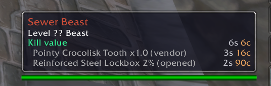

# Krool World Forever

Small quality-of-life features for **World of Warcraft: Forever**, in one addon. Each feature has its
own on/off switch, so you keep what you want and turn off the rest.

**[Download the latest release](https://github.com/Krool/KroolWorldForever/releases/latest)**

`/kw` (or the addon button on the minimap) opens the **Krool World hub**: one card per feature with
what it is doing right now, its on/off switch, and the way in (its window or its settings).

| Feature | What you get | Needs |
|---|---|---|
| **Quest Trash** | A keep or delete verdict on quest item tooltips. `/fqt` opens a window that sorts your bags (and bank) into Can Delete, Keep and Still Checking. | QuestieDB |
| **Kill Value** | Expected gold per kill on creature tooltips: coins plus each drop's chance times its price, plus the skinning if you can skin it. Learns real drop rates from what you loot. | Nothing (Auctionator optional) |
| **Setups** | Save a character's action bars, keybindings, macros, Edit Mode layout, interface settings, addon list and this addon's settings, then apply them to another character. A window shows which setup goes onto which character, and a check, warning or X per part afterwards. New characters can start from a saved setup. | Nothing |
| **Rare Alert** | A sound, a screen message and a chat line when a rare enemy is near, with what it is worth and its best drops, plus a skull button and a key that target it and mark it. Right-click the button to ignore a rare (the Stormwind canal crocolisk is ignored out of the box). Rares are noticed through enemy nameplates, which Forever starts with off: the hub's Plates On button turns them on. | Nothing |
| **Disenchant Value** | On weapon and armor tooltips (green and up): what the item disenchants into, what that is worth at auction, and whether disenchanting it pays more than auctioning or vendoring it. Hold Shift for each material's chance and price. | Auctionator (for prices) |

All five are on by default.



*Kill Value tooltip (earlier 1.12 version; a Forever screenshot is coming).*

## How it behaves

- **Advice only.** Quest Trash, Kill Value, Rare Alert and Disenchant Value never delete, sell, loot or click anything
  for you. Rare Alert's marker comes from your own click or key press: the game does not let an
  addon place one by itself. Setups is the one feature that changes your UI: only out of combat,
  only when you click Apply (or for a brand-new level 1 character, if you marked a setup for that),
  and always with an undo snapshot first. A character with any experience is never changed without
  a click.
- **Plays by Forever's addon rules.** Nothing reads combat data Blizzard hides from addons. Every
  feature checks for hidden ("secret") values and steps aside instead of erroring. Inside instances,
  where creature tooltip data is hidden, Kill Value shows nothing.
- **Errors stay out of your way.** Tooltip and event code runs protected, so a bad value skips a line
  instead of throwing a Lua error.

## Install

1. Download `KroolWorldForever-<version>.zip` from the
   [releases page](https://github.com/Krool/KroolWorldForever/releases/latest).
2. Unzip it into your Forever AddOns folder, so you end up with
   `World of Warcraft\_forever_\Interface\AddOns\KroolWorldForever\KroolWorldForever_Forever.toc`.
3. Restart the game (or `/reload`) and check that **Krool World Forever** is enabled in the AddOns list
   on the character screen.

Optional companions:

- **QuestieDB** (comes with Questie): required for Quest Trash. Without it Quest Trash says so at login
  and the other features work normally.
- **Auctionator**: auction house prices for Kill Value and Disenchant Value. Without it Kill Value
  uses vendor prices, and Disenchant Value names the materials without prices.

## Slash commands

| Command | What it does |
|---|---|
| `/kw` | Open the hub (again to close it) |
| `/kw settings` | Open the settings |
| `/kw list` | List the features and whether each is on |
| `/kw <feature>` | Open that feature's window, or its settings (`questtrash`, `killvalue`, `setups`, `rares`, `disenchant`) |
| `/kw <feature> on` / `off` | Turn one feature on or off |
| `/fqt` | Open the Quest Trash window: your bags (and the bank while it is open), deletables first |
| `/fqt print` / `status` | The same list in chat; whether the quest data is ready |
| `/fkv` | Full value breakdown for your target |
| `/fkv id <npcId>` | Breakdown for any creature by id |
| `/fkv status` / `config` / `help` | Data sources, current settings, all commands |
| `/fkv reset learned` | Erase the drop rates learned from your loot |
| `/kws` | Open the Setups window |
| `/kws save [name]` | Save this character as a setup |
| `/kws list` | List saved setups |
| `/kws undo` | Undo the last apply on this character |
| `/kwr ignore` | Ignore your target (or the last rare seen) |
| `/kwr unignore <name or id>` / `list` | Stop ignoring one; show the ignore list |
| `/kwr test` | Show the mark button with a test entry, to place it (shift-drag) and try your key |
| `/kwr nameplates` | Turn enemy nameplates on (rares are noticed as soon as their nameplate shows) |
| `/kwd` | Disenchanting material prices from Auctionator (which ones still have none) |

The mark key is under **Key Bindings > AddOns > Krool World**. `/kwf` and `/kroolworld` work like
`/kw`; `/questtrash`, `/killvalue`, `/kwsetups`, `/rarealert` and `/disenchantvalue` are long forms
of `/fqt`, `/fkv`, `/kws`, `/kwr` and `/kwd`.

## Settings

Every feature has a page under **Options > AddOns > Krool World Forever** with an Enabled switch and
its own settings. The tables below are generated from the features' own definitions by
`tools/settings-doc.js`. Do not edit them by hand.

<!-- settings:begin -->
### Quest Trash

Marks quest items you can safely delete on their tooltips. Needs QuestieDB.

On by default: yes. Toggle: `/kwf questtrash on|off`. Commands: `/fqt, /questtrash`.

| Setting | Default | What it does |
|---|---|---|
| Show Verdict on Tooltips | On | Adds a keep or delete line to quest item tooltips. |
| List the Quests Involved | On | Shows up to four quests and their status under the verdict. |

### Kill Value

Adds the expected gold per kill to creature tooltips: coins plus drop table times vendor or Auctionator prices.

On by default: yes. Toggle: `/kwf killvalue on|off`. Commands: `/fkv, /killvalue`.

| Setting | Default | What it does |
|---|---|---|
| Learn From My Loot | On | Records what corpses drop so new or rebalanced creatures get real numbers. |
| Use Vendor Prices | On | Vendor sell price as fallback and floor. |
| Use Auctionator Prices | On | If Auctionator is installed, price drops from the auction house minus the cut. |
| Add My Skinning To The Total | On | When you know Skinning (or Herbalism or Mining, for creatures gathered that way) with enough skill for the creature, its skinning value is part of the total. |
| Show Skinning Value | Off | Also shows the skinning value of creatures you cannot skin (not part of the total). |
| Show On Friendly Creatures | Off | Also adds the line to creatures you cannot attack. |
| Login Message | On | Prints one line at login. |
| Contributor Lines | 3 (0 to 10) | Top drops listed under the total (0 = none). |
| Auction House Cut % | 5 (0 to 100) | Taken off Auctionator prices. |

### Setups

Save a character's action bars, keybindings, macros, Edit Mode layout, interface settings, addon list and Krool World settings, and apply them to another character. /kws opens the window.

On by default: yes. Toggle: `/kwf setups on|off`. Commands: `/kws, /kwsetups`.

| Setting | Default | What it does |
|---|---|---|
| Offer A Setup On New Characters | On | The first time a character logs in with this addon, open the Setups window so you can start from a saved setup. Preselects the setup marked for new characters. |
| Apply The Default Setup Automatically | On | When a setup is marked Use For New Characters, a brand-new character (level 1, first login) gets it a few seconds after logging in, and the Setups window shows what changed. Characters that are not brand-new get the picker instead. Off: the picker opens instead. |
| Reload Automatically After Apply | On | Edit Mode layouts and the addon list take effect after a UI reload. On: Apply reloads by itself when needed. Off, and after the automatic apply on a new character (the game allows a reload only from a click): a Reload Now button appears. |
| Auto Snapshot Each Character | On | Keep one automatic setup per character, refreshed after login and shortly after you change bars, keybindings, macros, Edit Mode or settings, so any character can copy any other. |
| Applied Keybindings Are Per Character | On | On: applying a setup saves its keybindings for this character only. Off: for the whole account, which changes every character that uses account keybindings. |
| Clear Bar Slots The Setup Leaves Empty | On | On: an apply makes your bars match the setup exactly. Off: only fills slots, keeping anything already in a slot the setup leaves empty. |

### Rare Alert

Tells you when a rare enemy is near and gives you a button and a key that target it and put a raid marker on it. The game lets only a click or key press set a marker, so it never marks by itself.

On by default: yes. Toggle: `/kwf rares on|off`. Commands: `/kwr, /rarealert`.

| Setting | Default | What it does |
|---|---|---|
| Play A Sound | On | The raid warning sound when a rare shows up. |
| Show A Screen Message | On | The rare's name in the middle of the screen, like a raid warning. |
| Chat Message | On | One line in chat with the rare's name and level. |
| Show The Mark Button | On | A marker button near the top of the screen while a rare is near. Click it to target the rare and mark it; right-click ignores that rare; shift-drag moves it. The key in Key Bindings > AddOns > Krool World works either way. |
| Raid Marker | 8 (1 to 8) | Which marker the button puts on the rare: 8 skull, 7 cross, 6 square, 5 moon, 4 triangle, 3 diamond, 2 circle, 1 star. |

### Disenchant Value

On weapon and armor tooltips: what the item disenchants into, what that is worth at Auctionator's prices, and whether disenchanting pays more than the auction house or a vendor.

On by default: yes. Toggle: `/kwf disenchant on|off`. Commands: `/kwd, /disenchantvalue`.

| Setting | Default | What it does |
|---|---|---|
| Show On Item Tooltips | On | Adds the disenchant value to weapon and armor tooltips (green, blue and purple). |
| Say What Pays Best | On | Compares disenchanting with the item's own auction price and its vendor price, after the 5% auction cut. Bound items are compared only when you can disenchant them yourself. |
| Always List The Materials | Off | Lists each material with its chance and price. Off: hold Shift over the item to see them. |
<!-- settings:end -->

## FAQ

**Which game is this for?** World of Warcraft: Forever only (`_forever_` install folder, Interface
16001). It does not load on Classic Era, Anniversary or retail.

**Has it been tested in the live game?** It loaded with zero Lua errors in the Forever stress test.
The live game launches Nov 4, 2026; expect fixes in the first weeks.

**Where do Kill Value's numbers come from?** A vanilla 1.12 loot baseline (cmangos classic-db), blended
with the drop rates you record yourself as you loot. Forever may have rebalanced some loot, so creatures
you farm get more accurate over time.

**Why does Quest Trash say "keep" so often?** Every unknown fails toward keep. Tradable items are never
told "delete", and repeatable or seasonal quest items are always kept.

**Does Setups touch other characters?** Bars, macros, the addon list and per-character settings change
only on the character you apply to. Keybindings do too by default (a setting switches them to
account-wide). Some things the game stores for the whole account change for every character:
account-wide interface settings, Edit Mode's own checkboxes, and this addon's settings.

**Where do Disenchant Value's tables come from?** The vanilla 1.12 disenchant tables (cmangos
classic-db): exact for classic items, and by quality, weapon or armor and item level for items new
to Forever. Forever's disenchanting looks the same so far (same dust, essence and shard tiers);
if you see it differ, please open an issue. Auctionator has a disenchant line too, but on Forever it loads its retail
tables, so items of classic levels get none. "Best" compares after the 5% auction cut, and before
any tip you give a disenchanter.

**Is this allowed?** Yes. It uses only the standard addon API: tooltips, the loot window, and (for
Setups) the same bar, binding and macro calls any action bar profile addon uses, out of combat.

**Why doesn't Rare Alert just mark the rare?** Since Midnight, which Forever is built on, setting a
raid marker is protected: only a click or key press may do it. The button and key run
`/targetexact <rare>` and `/tm` for you, one press. They can change only out of combat, so a rare
found in combat gets the alert, and the button catches up when combat ends. If you already use
RareScanner or SilverDragon (both have Forever builds), turn off Rare Alert's sound and screen
message and keep the button.

## Development

```
.\scripts\link-addon.ps1 -AddOnsPath "<WoW>\_forever_\Interface\AddOns"   # junction for dev
cd tools\test; npm install; npm test                                       # all suites + API lint
.\scripts\build.ps1                                                        # dist\KroolWorldForever-<v>.zip
.\scripts\release.ps1 -Version x.y.z [-Publish]                            # see CLAUDE.md
```

- `KroolWorldForever/` is the shipped addon: `Core/` (registry, settings panel, lifecycle) and
  `Features/<Name>/` (one folder per feature).
- `tools/test/<feature>/` holds one suite per feature: a stub client plus behavior checks. Each suite
  loads the whole bundle under fengari.
- `tools/forever-api/` holds the API allowlist lint. It checks every `C_*` call, event and `Enum`
  against Forever's API docs.
- `tools/killvalue-data/` holds the Kill Value loot data generator (cmangos classic-db).
- `tools/bugs.js` prints the Lua errors !BugGrabber saved in your Forever install.
- `template/HelloForever` is a minimal addon skeleton.

### Research notes

| File | What it covers |
|---|---|
| [docs/01-game-overview.md](docs/01-game-overview.md) | What the game is, features, timeline, business model |
| [docs/02-addon-platform.md](docs/02-addon-platform.md) | Forever's technical facts: TOC, project ID, API base, restrictions, ecosystem |
| [docs/03-toolchain.md](docs/03-toolchain.md) | Addon anatomy, editor setup, in-game tools, libraries, packaging, addon policy |
| [docs/04-launch-checklist.md](docs/04-launch-checklist.md) | What to verify once the game is installed |
| [docs/05-opportunities.md](docs/05-opportunities.md) | Gaps and addon ideas |
| [docs/07-fog-control.md](docs/07-fog-control.md) | Fog/weather control: what Blizzard locked, what is left |
| [docs/features/](docs/features) | Per-feature design notes and honest limits |
| [docs/sources.md](docs/sources.md) | Sources with confidence tags |

## License

Code: [MIT](LICENSE), by Krool. Kill Value's loot baseline and Quest Trash's repeatable quest list are
extracted from [cmangos classic-db](https://github.com/cmangos/classic-db) (GPL-3.0); see LICENSE.
Quest data is read at runtime from [QuestieDB](https://github.com/Questie/QuestieDB), which is not bundled.
