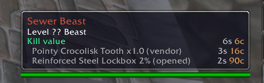

# Krool World Forever

Small quality-of-life features for **World of Warcraft: Forever**, in one addon. Each feature has its
own on/off switch, so you keep what you want and turn off the rest.

**[Download the latest release](https://github.com/Krool/KroolWorldForever/releases/latest)**

| Feature | What you get | Needs |
|---|---|---|
| **Quest Trash** | A keep or delete verdict on quest item tooltips. `/fqt` lists everything in your bags (and bank) you can throw away. | QuestieDB |
| **Kill Value** | Expected gold per kill on creature tooltips: coins plus each drop's chance times its price. Learns real drop rates from what you loot. | Nothing (Auctionator optional) |
| **Setups** | Save a character's action bars, keybindings, macros, Edit Mode layout, interface settings and addon list, then apply them to another character. New characters can start from a saved setup. | Nothing |

All three are on by default.



*Kill Value tooltip. This shot is from the earlier 1.12 version (OctoKillValue); a Forever screenshot
will replace it.*

## How it behaves

- **Advice only.** Quest Trash and Kill Value never delete, sell, loot or click anything for you.
  Setups is the one feature that changes your UI: only out of combat, only when you click Apply (or
  for a brand-new character, if you marked a setup for that), and always with an undo snapshot first.
- **Plays by Forever's addon rules.** Nothing reads combat data Blizzard hides from addons. Every
  feature checks for hidden ("secret") values and steps aside instead of erroring. Inside instances,
  where creature tooltip data is hidden, Kill Value shows nothing.
- **Errors stay out of your way.** Tooltip and event code runs protected, so a bad value skips a line
  instead of throwing a Lua error.

## Install

1. Download `KroolWorldForever-<version>.zip` from the
   [releases page](https://github.com/Krool/KroolWorldForever/releases/latest).
2. Unzip it into your Forever AddOns folder, so you end up with
   `World of Warcraft\_forever_\Interface\AddOns\KroolWorldForever\KroolWorldForever_Forever.toc`.
3. Restart the game (or `/reload`) and check that **Krool World Forever** is enabled in the AddOns list
   on the character screen.

Optional companions:

- **QuestieDB** (comes with Questie): required for Quest Trash. Without it Quest Trash says so at login
  and the other features work normally.
- **Auctionator**: auction house prices for Kill Value. Without it Kill Value uses vendor prices.

## Slash commands

| Command | What it does |
|---|---|
| `/kwf` | Open the settings |
| `/kwf list` | List the features and whether each is on |
| `/kwf <feature> on` / `off` | Turn one feature on or off (`questtrash`, `killvalue`, `setups`) |
| `/fqt` | Scan your bags (and the bank while it is open) and print every verdict, deletables first |
| `/fqt status` | Show whether the quest data is ready |
| `/fkv` | Full value breakdown for your target |
| `/fkv id <npcId>` | Breakdown for any creature by id |
| `/fkv status` / `config` / `help` | Data sources, current settings, all commands |
| `/fkv reset learned` | Erase the drop rates learned from your loot |
| `/kws` | Open the Setups window |
| `/kws save [name]` | Save this character as a setup |
| `/kws list` | List saved setups |
| `/kws undo` | Undo the last apply on this character |

`/questtrash`, `/killvalue` and `/kwsetups` work as long forms of `/fqt`, `/fkv` and `/kws`.

## Settings

Every feature has a page under **Options > AddOns > Krool World Forever** with an Enabled switch and
its own settings. The tables below are generated from the features' own definitions by
`tools/settings-doc.js`. Do not edit them by hand.

<!-- settings:begin -->
### Quest Trash

Marks quest items you can safely delete on their tooltips. Needs QuestieDB.

On by default: yes. Toggle: `/kwf questtrash on|off`. Commands: `/fqt, /questtrash`.

| Setting | Default | What it does |
|---|---|---|
| Show Verdict on Tooltips | On | Adds a keep or delete line to quest item tooltips. |
| List the Quests Involved | On | Shows up to four quests and their status under the verdict. |

### Kill Value

Adds the expected gold per kill to creature tooltips: coins plus drop table times vendor or Auctionator prices.

On by default: yes. Toggle: `/kwf killvalue on|off`. Commands: `/fkv, /killvalue`.

| Setting | Default | What it does |
|---|---|---|
| Learn From My Loot | On | Records what corpses drop so new or rebalanced creatures get real numbers. |
| Use Vendor Prices | On | Vendor sell price as fallback and floor. |
| Use Auctionator Prices | On | If Auctionator is installed, price drops from the auction house minus the cut. |
| Show Skinning Value | Off | Adds a skinning/gathering line (not part of the total). |
| Show On Friendly Creatures | Off | Also adds the line to creatures you cannot attack. |
| Login Message | On | Prints one line at login. |
| Contributor Lines | 3 (0 to 10) | Top drops listed under the total (0 = none). |
| Auction House Cut % | 5 (0 to 100) | Taken off Auctionator prices. |

### Setups

Save a character's action bars, keybindings, macros, Edit Mode layout, interface settings and addon list, and apply them to another character. /kws opens the window.

On by default: yes. Toggle: `/kwf setups on|off`. Commands: `/kws, /kwsetups`.

| Setting | Default | What it does |
|---|---|---|
| Offer A Setup On New Characters | On | The first time a character logs in, open the Setups window so you can start from a saved setup. Preselects the setup marked for new characters. |
| Apply The Default Setup Automatically | On | When a setup is marked Use For New Characters, a brand-new character gets it a few seconds after its first login, with no picker. Off: the picker opens instead. |
| Reload Automatically After Apply | On | Edit Mode layouts and the addon list only take effect after a UI reload. On: applying reloads by itself when needed and prints the report again afterwards. Off: a Reload button appears. |
| Auto Snapshot Each Character | On | Keep one automatic setup per character, refreshed after login and shortly after you change bars, keybindings, macros, Edit Mode or settings, so any character can copy any other. |
| Applied Keybindings Are Per Character | On | On: applying a setup saves its keybindings for this character only. Off: for the whole account, which changes every character that uses account keybindings. |
| Clear Bar Slots The Setup Leaves Empty | On | On: an apply makes your bars match the setup exactly. Off: only fills slots, keeping anything already in a slot the setup leaves empty. |
<!-- settings:end -->

## FAQ

**Which game is this for?** World of Warcraft: Forever only (`_forever_` install folder, Interface
16001). It does not load on Classic Era, Anniversary or retail.

**Has it been tested in the live game?** It loaded with zero Lua errors in the Forever stress test.
The live game launches Nov 4, 2026; expect fixes in the first weeks.

**Where do Kill Value's numbers come from?** A vanilla 1.12 loot baseline (cmangos classic-db), blended
with the drop rates you record yourself as you loot. Forever may have rebalanced some loot, so creatures
you farm get more accurate over time.

**Why does Quest Trash say "keep" so often?** Every unknown fails toward keep. Tradable items are never
told "delete", and repeatable or seasonal quest items are always kept.

**Does Setups touch other characters?** Only the character you apply a setup to. Keybindings are saved
per character by default (a setting switches that to account-wide).

**Is this allowed?** Yes. It uses only the standard addon API: tooltips, the loot window, and (for
Setups) the same bar, binding and macro calls any action bar profile addon uses, out of combat.

## Development

```
.\scripts\link-addon.ps1 -AddOnsPath "<WoW>\_forever_\Interface\AddOns"   # junction for dev
cd tools\test; npm install; npm test                                       # all suites + API lint
.\scripts\build.ps1                                                        # dist\KroolWorldForever-<v>.zip
.\scripts\release.ps1 -Version x.y.z [-Publish]                            # see CLAUDE.md
```

- `KroolWorldForever/` is the shipped addon: `Core/` (registry, settings panel, lifecycle) and
  `Features/<Name>/` (one folder per feature).
- `tools/test/<feature>/` holds one suite per feature: a stub client plus behavior checks. Each suite
  loads the whole bundle under fengari.
- `tools/forever-api/` holds the API allowlist lint. It checks every `C_*` call, event and `Enum`
  against Forever's API docs.
- `tools/killvalue-data/` holds the Kill Value loot data generator (cmangos classic-db).
- `tools/bugs.js` prints the Lua errors !BugGrabber saved in your Forever install.
- `template/HelloForever` is a minimal addon skeleton.

### Research notes

| File | What it covers |
|---|---|
| [docs/01-game-overview.md](docs/01-game-overview.md) | What the game is, features, timeline, business model |
| [docs/02-addon-platform.md](docs/02-addon-platform.md) | Forever's technical facts: TOC, project ID, API base, restrictions, ecosystem |
| [docs/03-toolchain.md](docs/03-toolchain.md) | Addon anatomy, editor setup, in-game tools, libraries, packaging, addon policy |
| [docs/04-launch-checklist.md](docs/04-launch-checklist.md) | What to verify once the game is installed |
| [docs/05-opportunities.md](docs/05-opportunities.md) | Gaps and addon ideas |
| [docs/07-fog-control.md](docs/07-fog-control.md) | Fog/weather control: what Blizzard locked, what is left |
| [docs/features/](docs/features) | Per-feature design notes and honest limits |
| [docs/sources.md](docs/sources.md) | Sources with confidence tags |

## License

Code: [MIT](LICENSE), by Krool. Kill Value's loot baseline and Quest Trash's repeatable quest list are
extracted from [cmangos classic-db](https://github.com/cmangos/classic-db) (GPL-3.0); see LICENSE.
Quest data is read at runtime from [QuestieDB](https://github.com/Questie/QuestieDB), which is not bundled.
